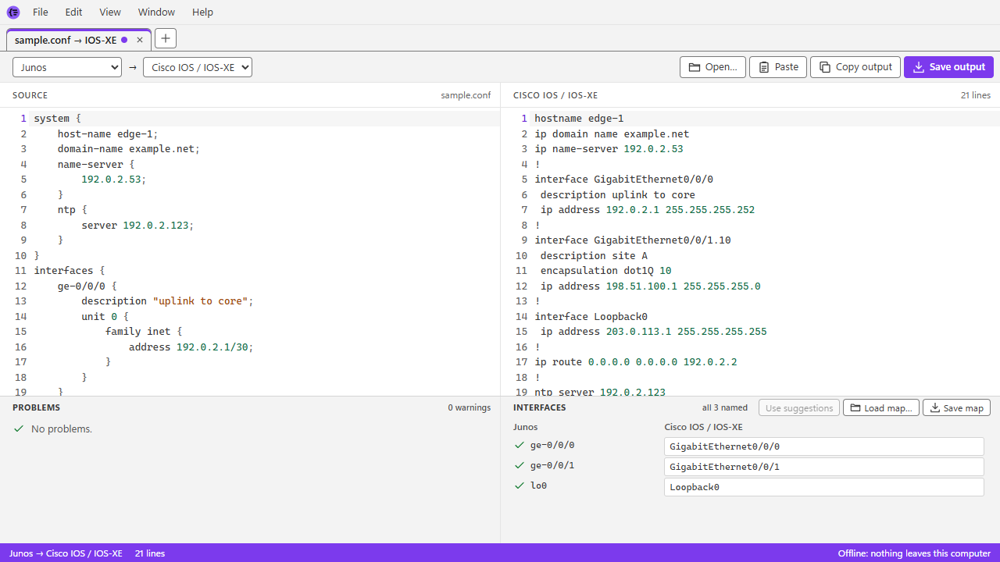
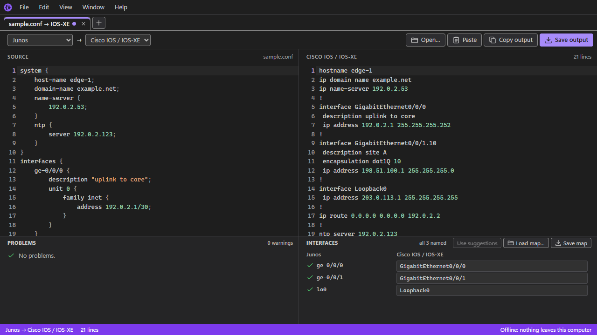

# Dialect

Dialect translates network device configs between vendor "dialects", offline. It turns hierarchical Junos config into
`display set` commands, and converts configs between Junos, Cisco IOS / IOS-XE, NX-OS and IOS-XR: interfaces and
VLANs, static routes, OSPF and BGP, routing policy and filters, with each platform built as its own plugin. What it
can't convert is listed, never dropped silently. It comes as a desktop app for Windows, an offline single-file web page
and a command-line tool, all from one TypeScript core, and nothing ever leaves your computer.



<details>
<summary>The same in the dark theme</summary>



</details>

## Review before applying

Always review converted configuration before applying it to a device. Dialect reports what it couldn't convert, but
you are responsible for what you deploy.

## Getting Dialect

Download Dialect from **[Releases](https://github.com/Suremise/dialect/releases)** (in the app: Help → Releases on
GitHub). Each release has four downloads, for Windows (x64). None needs anything else installed: no Node.js, no
runtime.

| Download | What it is |
|---|---|
| `Dialect_<version>_x64-setup.exe` | **The one most people want.** The desktop app and the `dialect` command, for you alone (no admin rights). It needs internet only on the rare PC without Microsoft WebView2 (every Windows 11 and an up-to-date Windows 10 have it). |
| `Dialect_<version>_x64-offline-setup.exe` | The same, for a PC with no internet: Microsoft's WebView2 installer is inside, so it's much bigger. |
| `dialect-cli.exe` | The `dialect` command on its own: one file, nothing to install. Rename it `dialect.exe` to type `dialect`. |
| `dialect.html` | The app as one web page: open it in Edge or Chrome, from any folder or a USB stick, with no network. |

Until Dialect has a code-signing certificate, Windows SmartScreen may warn about the downloads: choose **More info** →
**Run anyway**. `THIRD_PARTY_NOTICES.md` comes with each release, and the release notes give each download's SHA-256.
Dialect doesn't update itself or check for new versions yet: look at Releases for them. The
[user guide](docs/USER_GUIDE.md) (also in the app, F1) says how to use it.

## More about the project

- Product decisions: [docs/SPEC.md](docs/SPEC.md)
- How the code fits together: [docs/ARCHITECTURE.md](docs/ARCHITECTURE.md)
- The research behind the design, and the build plan: [docs/spike-desktop-app.md](docs/spike-desktop-app.md)
- How a release is made: [RELEASING.md](RELEASING.md)
- For agents working on the repo: [AGENTS.md](AGENTS.md)

## Building

Needs Node 24 and npm 12. The repo pins npm 12.2.0, whose install scripts are denied by default, but a global npm may
stay at 11 (Hive, on the same PC, uses it). Run npm 12 through `npx` for installs and tests instead:

```sh
npx npm@12.2.0 install    # or ci
npm run typecheck
npm run lint
npx npm@12.2.0 test
```

Under npm 11, `npm test` skips the npm 12 install-script checks with a warning; CI runs them, on npm 12.

The desktop app and the license check (which lists its Rust crates) also need Rust, through
[rustup](https://rustup.rs), and the Visual Studio C++ build tools. `npm run build -w @dialect/desktop` makes the
installer, and `npm run build:installers -w @dialect/desktop` both (normal and offline); `npm run test:smoke -w
@dialect/desktop` runs its smoke test (docs/ARCHITECTURE.md, The desktop app). `npm run build:exe -w @dialect/cli`
makes the standalone `dialect.exe` (with the Node version `scripts/notices/node.md` is for).

## License

MIT, see `LICENSE`. Third-party material that ships is listed in `THIRD_PARTY_NOTICES.md` and the tools used only to build in `docs/BUILD_ONLY_PACKAGES.md`, both generated by `npm run licenses`.

## Trademarks

© 2026 Darren Marshall. Dialect is independently developed and isn't affiliated with, endorsed or sponsored by Juniper Networks or Cisco Systems. Juniper and Junos are trademarks of Juniper Networks, Inc.; Cisco, IOS, IOS-XE, NX-OS and IOS-XR are trademarks of Cisco Systems, Inc.

## Contributing rules

- **Licenses come in two categories** (docs/SPEC.md §3):
  - **What ships, or is copied into the repo** (dependencies bundled into the app, the web build or the CLI, copied code, test data) must be MIT or equally permissive: MIT, Apache-2.0 (keep its NOTICE text), BSD, ISC, Zlib, Unicode-3.0 and the like. MPL-2.0 used unmodified is allowed. No GPL, LGPL, AGPL or other copyleft, and nothing without a license.
  - **Build-only tools** that never ship (compilers, linters, test runners, the icon pipeline) may use any open-source license, GPL and LGPL included. They are listed as build-only.

  `npm run licenses` regenerates the notices and checks the rule; commit what it writes. Material that isn't a package gets a hand-written entry in `scripts/notices` (Apache-2.0 also needs its NOTICE text).
- **Sample configs and test fixtures must be cleaned up first.** Before committing one, remove passwords and password hashes, SNMP communities, keys, real public IP addresses, hostnames and customer names. Use documentation ranges instead: `192.0.2.0/24`, `198.51.100.0/24`, `203.0.113.0/24` and `2001:db8::/32`. The one exception is unchanged published test data in `fixtures/public/`, kept byte-for-byte with its provenance, license and scan flags in `fixtures/manifest.json` (see [fixtures/README.md](fixtures/README.md)); everything else, `fixtures/private-cleaned/` included, must be cleaned first.
